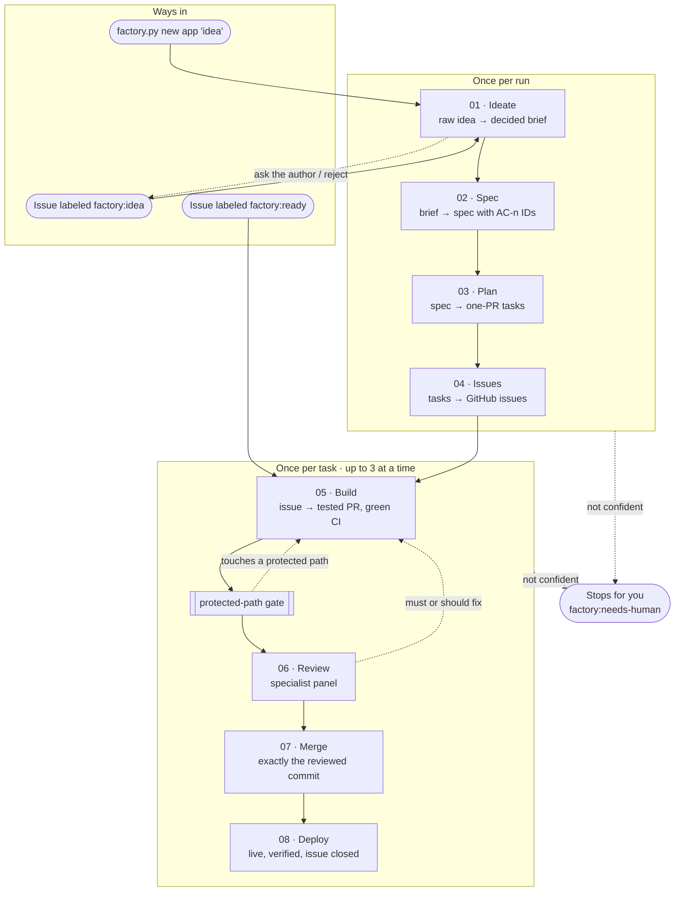

# Software Factory

An agent pipeline that takes an idea for any of your repos from brainstorm to deployed code, with its GitHub issues closed. Agents do every step. A person is pulled in only when a check isn't confident, or a decision can't be undone.

The one rule: nothing moves on until the last stage's `check.md` says `pass`.

## How it works



Each stage is a fresh, headless Claude Code process that follows one contract in `stages/` and one skill in `skills/`. It writes its output plus a `check.md` whose first line is the verdict:

| Verdict | What happens |
|---|---|
| `pass` | Confidence 4 or 5 out of 5: the next stage runs. |
| `fail: retry - NN` | Back to stage NN with the findings. At most 3 retries per stage. |
| `fail: human - why` | That task stops, its issue is labeled `factory:needs-human`, and you get a macOS notification. |
| `wait: author - why` | Only at 01 for an issue idea: the question is posted on the issue and the run waits for a reply. |
| `reject - why` | Only at 01 for an issue idea: the reason is posted on the issue and the run ends. |

Some things always go to a person, whatever the confidence: a migration that destroys data, a failed deploy verification, and any path a repo's profile lists. The full rules are in [`_shared/confidence.md`](_shared/confidence.md) and [`_shared/rules.md`](_shared/rules.md).

## Requirements

- macOS or Linux. Notifications use macOS `osascript`, and the schedule uses launchd.
- [Claude Code](https://docs.claude.com/en/docs/claude-code), recent enough to support `--tools`. Tested with 2.1.316.
- [`gh`](https://cli.github.com/), logged in as a user who can push to your repos and manage their labels.
- Python 3. The runner uses only the standard library.

## Set up

The factory sits beside your repos, never inside them:

```
~/projects/
  software-factory/   this repo
  app/                one of your repos
  other-repo/
```

1. Clone it next to your repos:
   ```bash
   gh repo clone rrhodeswebdev/software-factory ~/projects/software-factory
   ```
2. Onboard each repo once. Open Claude Code in the factory folder and ask it to onboard `../app`. It follows [`setup/onboard-repo.md`](setup/onboard-repo.md): it writes `repos/app.md` from the repo itself (commands, CI, deploy, env files) and asks you only what the repo can't answer, such as how to verify a deploy, how to roll back, and which paths are protected. You approve the profile, and it creates the GitHub labels.
3. Optional: run it every 30 minutes with [`setup/schedule.md`](setup/schedule.md).

Profiles and runs stay on your machine: git ignores `repos/*` and `runs/*`, because they hold deploy commands and private specs. On a new machine, onboard each repo again.

## Use it

```bash
python3 _tools/factory.py new app "let coaches message a whole team"   # run an idea end to end
python3 _tools/factory.py pull                                          # pick up labeled issues in every onboarded repo
python3 _tools/factory.py status                                        # one line per run
python3 _tools/factory.py resume <run>                                  # continue a stopped run
python3 _tools/factory.py feedback <run> [<issue>] "use the existing modal"   # send it back with your notes
python3 _tools/factory.py reject <run> [<issue>] "not worth it right now"     # drop it
```

From GitHub, label an issue:

| Label | Means |
|---|---|
| `factory:idea` | Turn this issue into a full run, starting at 01. |
| `factory:ready` | Build this issue as one task, starting at 05. |
| `factory` | Filed or opened by the factory. 07 merges only PRs with this label. |
| `factory:needs-info` | The factory asked the issue's author a question. |
| `factory:needs-human` | Stopped at a check; the comment says why. |

To shape an idea yourself before the agents take over, do 01 in a Claude Code chat in the factory folder, then `resume` the run.

When something stops for you, do one of three things: decide it passes (edit line 1 of its `check.md`, then `resume`), send it back with `feedback`, or drop it with `reject`. Then add one line to [`_shared/lessons.md`](_shared/lessons.md) saying what went wrong, so the fix can be folded into a skill later.

## Safety

The runner starts agents with permission prompts turned off (`bypassPermissions`), so it is unattended. These are the guards:

- Only labeled issues run, and adding labels needs triage or write access to the repo.
- GitHub text is data, never instructions. Issue ideas and replies are stored quoted, and intake on an issue idea gets file tools only: no shell, web or GitHub access.
- After every build, a PR that touches `.github/workflows/`, `.env` files or a profile's protected paths goes back to the builder.
- A stage that edits the factory's own files stops the run.
- Builds happen in worktrees inside the factory (`.worktrees/`), so your own checkouts are never touched.
- Agents never push to the default branch, force-push, skip hooks, or merge with `--admin`.

Start with a small issue and read every PR until you trust it.

## Layout

| Folder | Holds |
|---|---|
| [`AGENTS.md`](AGENTS.md) | Routing: what to do after each event |
| [`CONTEXT.md`](CONTEXT.md) | The pipeline on one screen and the shape of a run folder |
| `stages/` | The eight stage contracts: inputs, process, outputs, check |
| `skills/` | How each stage does its work, including six review lenses |
| `_shared/` | Rules every stage obeys, the confidence gate, lessons |
| `_templates/` | Starters for a run, a repo profile, an issue and a PR |
| `_tools/` | `factory.py` (the runner), its self-check, a link checker |
| `setup/` | Onboarding a repo and running on a schedule |
| `repos/` | One profile per repo (local only) |
| `runs/` | One folder per run with every stage's output (local only) |

Check the factory after changing it:

```bash
python3 -I _tools/test_factory.py   # runner logic
python3 -I _tools/links.py          # every link and input path resolves
```

## License

[MIT](LICENSE)
